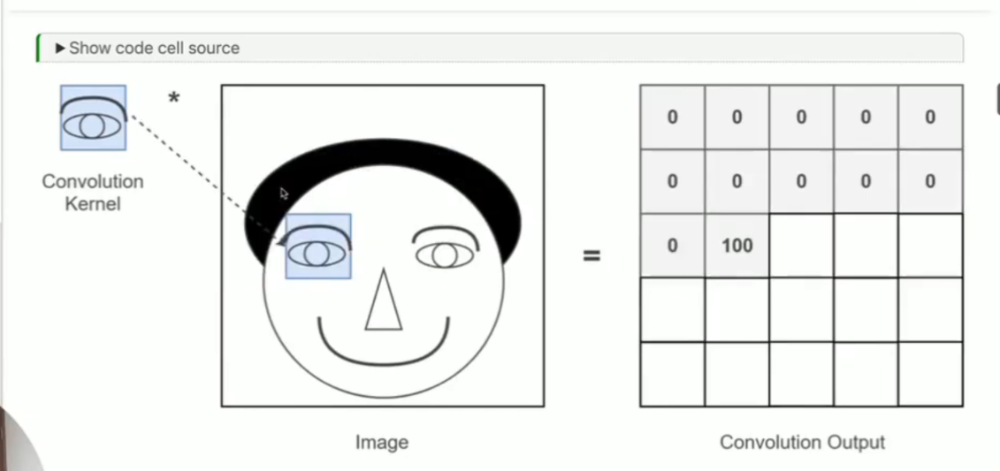

computer vision is bascally enabling the models to learn abou the images and videos . the inout is an image which passes through a dl,ml ,non-mml models and gives us some predictions 

# MACHINE LEARNING VS DEEP LEARNING :
in trditional machine lerning we gve data + feature extractiona and then feed it to th model and then it makes the prediction ....... but in the Deep learning we just feed the data and  the neural network does the feature extraction and classification by its own and give us the prediction because we struggle a lot in the feature extraction and here deep learning got so much importance 

# TRADITIONAL CV WITH TH USE OF FILTERS :
filters are the matrices which we hand written with some logi behind it .then this convoled with the image to detect the edges,shapes,corners,horizontal lines,edges ,vertical edges and any other features in the image .
 
we multiply each filter ntry with the corresponding pixel intensity and the poduct produces the new single intensity... agar padding nahi dale to jo output image rahegi wo output ke dimesnion ki hi rshegi (simply dekhneka ki kernel kitne baar ek pur row me float karta to utn he dimension ka ouput image rahega ) and padding dale to image ke dimension ka he output rahwega 

# edge : sudden chage in the intensity pixel 
agar pixel value very low value se achanak jump karti hai to high value and vice versa rhen we can say there is a presence of the edges 

# types of filters 
# 1.sobel and prewitt
sobel and prewit have 2 filtes gx and gy whihc detecs edges in the vertical and horizontal edeges 

# 2.laplacian filter
it uses the second derivtive of image intensity and detectes the edegs all at onces measn there are no 2 filters for x axis and y axis  so in a single response only it can detect the edges all at once 

# learing rate :-
it means how quickly model is updating and if it too small it wil be too small nd too bifg then we can mis the local minima 

# hyperparametrs
epochs
learning rate
batch size 
nodes in hidden layer 
img height/width

# W&B is used today in real-world ML and AI engineering workflows. It is especially useful when teams train multiple models, compare experiments, tune hyperparameters, and track results.
uv add wandb
wandb login

# overfitting prevention techniques 
# 1.regularization :
it adds a penalty to the loss term 
l1(lasso) It adds the absolute values of the model weights to the loss. ansd push ome wieghts exactly to zero and does automatic feature selection 

l2(ridge) :It adds the squared values of the model weights to the loss.  shrnks the weights to zeo and doesnt make it zero 

# 2 .dropout layers 
dropput is also a regularization technique which randomly switches off some neurons duyring the training phase so that  other neurons are not toallat dpendent on a s epcific neuron depending on the p va;lue like 0l.1,0.2 ,0.5 which is 10 %,20%,50% some neurons duringf the training phase only it is switched off and during the inference all the neurons are active . it prevens overfitting because for eg uin a group here is one student who knows all the naswers then all the other students are deondent of thta student but if that student is unavailable then entire group is going to struggle but if everyone know sme concepts then the group will excel the same idea is the droput layers 

# 3.early stopping 
Early stopping is a regularization technique used to prevent overfitting. During training, we monitor the model's performance on validation data. When the validation loss stops improving for a specified number of epochs, called patience, we stop training. By restoring the best weights, we retain the model that performed best on the validation data.

# 4.batch normalization 
Batch Normalization is a technique used in deep neural networks to normalize layer activations using the mean and variance of a mini-batch. It then applies learnable scale(gamma) and shift(beta) parameters. This often makes training more stable and faster, and it can provide a mild regularization effect. During inference, BatchNorm typically uses running estimates of the mean and variance collected during training.

# note: wven though we used these techiques to increase the validation accuracy te accuray wa almost similar and didint increase becausewe were training the model from strach which was havng only just 5 classses so now w will be using the techniques of transfer learning , pretrained embedding and fine tuning 

# 1. pretrained embeddding :
A pretrained embedding is a vector representation generated by a model that has already learned useful patterns from training data.
pretrned model is the nn that has already been trained on the huge amount of data for eg .imagenet and has teha bility to perform feature extraction like patterns,edges,shapes,texture,full objects

# 2.transfer learning 
it means using already trained model and then reuiusng it for the new task 

 # a. fixed feature extraction : freexe the pretrained model and use it to just extract the fetures 
 # b.fine tuning : unfreexing the top layers and retraining for better adaption 

 # CNN
 pooling is a technique in cnn that reduces the size of the feature maop whilke retaining the important information . types are max pooling average pooling , max pooling is mostly used ..basically it is a downsampling technique

 # alexnet complete;y chnages the dnn
 it changes how computer visiosn was implemented AlexNet is one of the CNN architectures that made deep learning famous for image classification. It won the ImageNet Large Scale Visual Recognition Challenge (ILSVRC) in 2012 and helped popularize deep CNNs for computer vision.

